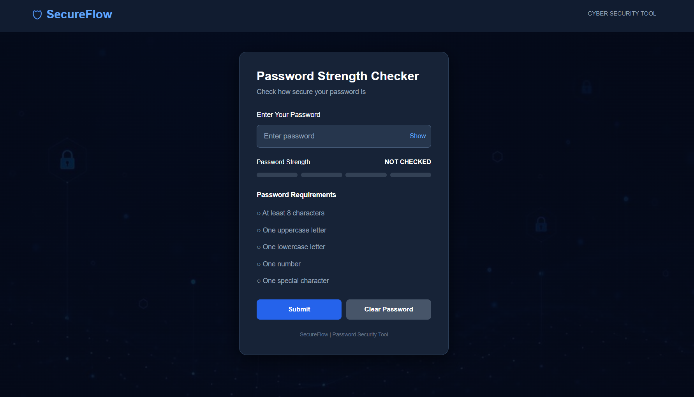
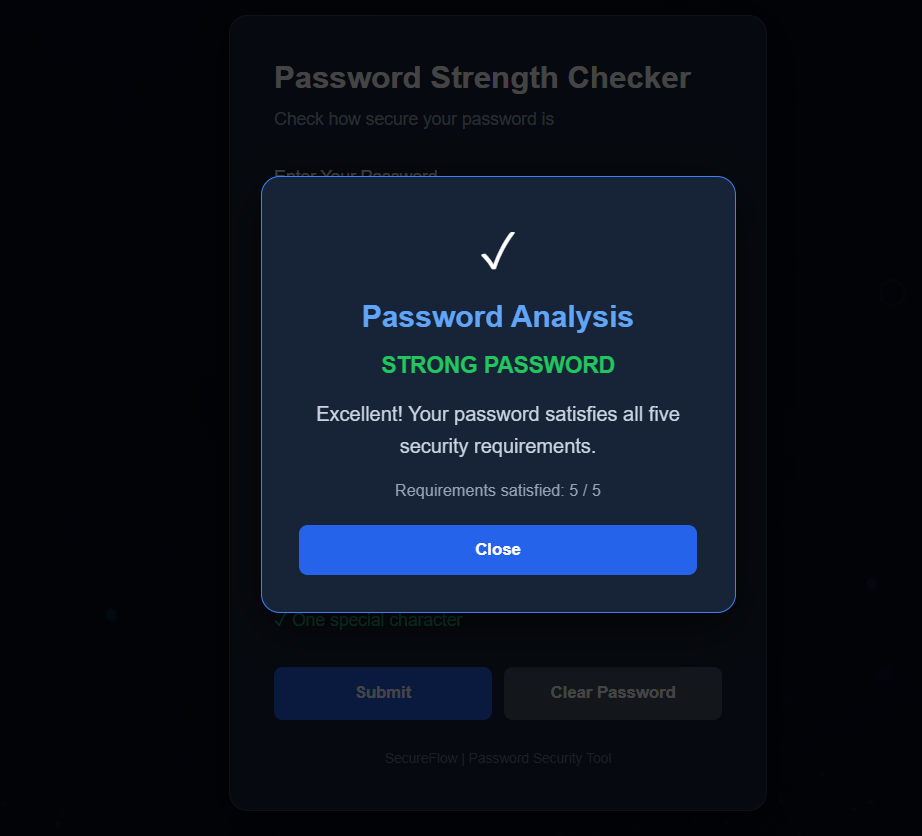

# 🔐 SecureFlow – Password Security Checker

## 📌 Project Overview
SecureFlow is a web-based password security checker developed using HTML, CSS, and JavaScript. It helps users evaluate the strength of their passwords and understand basic password security practices through a simple and interactive interface.

## 🎯 Internship Details
- **Intern ID:** CIS467
- **Full Name:** Lathikka M
- **Internship Duration:** 4 weeks
- **Project Name:** SecureFlow – Password Security Checker

## 🎯 Project Scope
The main objective of this project is to provide users with an easy way to check password strength. The application evaluates passwords based on security criteria and provides feedback to encourage users to create stronger passwords.

## ✨ Features
- Password strength evaluation
- Password visibility toggle
- Interactive user interface
- Password security feedback
- Background image design
- User-friendly experience

## 🛠️ Technologies Used
- HTML5 – Web page structure
- CSS3 – Styling and layout
- JavaScript – Password validation and functionality

## 📸 Screenshots
Screenshots of the application interface and password strength evaluation will be included here.

### Homepage

### Password Strength Result

## 📚 Project Outcome
This project demonstrates the practical implementation of frontend web development concepts and basic cybersecurity principles related to password security.

## 👩‍💻 Developed As
CODTECH IT Solutions Internship Project

---

**Project:** SecureFlow – Password Security Checker  
**Technologies:** HTML, CSS, JavaScript